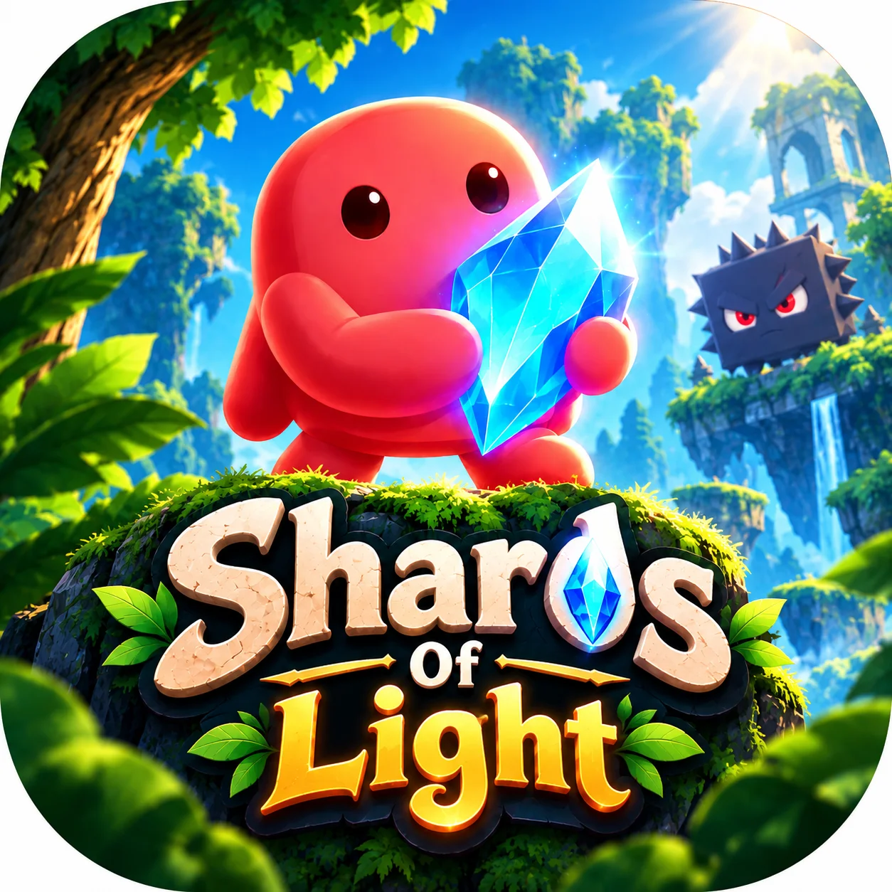

# Shards Of Light

<!-- Add your approved game logo at assets/logo.webp to display it here. -->

**Collect the shards. Bring back the light!**

_A story-driven, offline 2D platformer built with Unity 6 for Android._

[**Google Play**](https://play.google.com/store/apps/details?id=com.virtuenetz.shardsoflight) · [**Official Website**](https://shards-of-light.vercel.app/)

> **Company Product · Unity Game · Released on Google Play**  
> Shards Of Light is a game I developed as part of my professional work at **VirtueNetz**. I handled the game development, gameplay systems, level implementation, and Android delivery. This repository is a public showcase of the shipped game; production project files and source code are not included.

## Overview

**Shards Of Light** follows Rubi, the guardian of a magical crystal, across snowy worlds after enemies shatter the crystal and scatter its pieces. Players run, jump, climb, swing, avoid traps, defeat enemies, and collect shards to restore the light.

The Android game is **fully playable offline**, requires **no account**, and saves level progress locally on the device. Network access may be used for optional advertising and connected services.

## My Development Work

I developed this game at **VirtueNetz**, with responsibility for:

- Gameplay programming in **Unity and C#**
- Character movement, touch controls, and interactions
- Level implementation, obstacles, puzzles, collectibles, and checkpoints
- Enemy behavior and multi-phase boss encounters
- Three-star scoring, unlocks, and device-local progress persistence
- Cinematic sequences, camera behavior, and transitions
- Audio integration, effects, and settings
- UI, menus, player feedback, and gameplay polish
- Android optimization, testing, and production release
- Generating approximately **30–40% of the game assets** and integrating other appropriately sourced assets and music

## Features

- **Touch-first platforming:** run, jump, climb ladders, and swing on ropes
- **Seven levels:** progressing through frozen environments and boss encounters
- **Three-star completion:** earn separate stars for collecting all coins, letters, and gems
- **Environmental challenges:** slippery surfaces, falling stones, rolling snowballs, spikes, moving platforms, and box puzzles
- **Enemy variety:** patrol, airborne, ranged, and environmental threats
- **Boss encounters:** scripted multi-phase fights
- **Cinematic storytelling:** cutscenes and camera sequences using Timeline and Cinemachine
- **Offline progress:** local level unlocks and completion results
- **Audio and settings:** scene-specific music, interaction effects, and volume controls
- **Optional monetization:** rewarded revives and interstitial advertising via AdMob

## The Story

Rubi protects a magical crystal whose light keeps the world warm and bright. When enemies break the crystal and scatter its shards, the world begins to fade. Rubi sets out across the frozen lands to recover the missing pieces and restore the light.

## Levels

| #   | Level                          |
| --- | ------------------------------ |
| 1   | The Broken Morning             |
| 2   | The Crystal Trail              |
| 3   | The Crystal Battle             |
| 4   | The Frozen Path                |
| 5   | The Frozen Switch              |
| 6   | Another Frozen Switch          |
| 7   | The Frozen Battle — final boss |

## Gameplay Systems

| System          | Implementation focus                              |
| --------------- | ------------------------------------------------- |
| Player controls | Mobile movement, jumping, ladders, ropes          |
| Collectibles    | Coins, letters, crystal gems                      |
| Progression     | Three-star scoring, level unlocking, local saves  |
| Encounters      | Enemy behavior, damage, checkpoints, boss phases  |
| Level mechanics | Traps, platforms, movable boxes, puzzles          |
| Presentation    | Cutscenes, cameras, animation, audio              |
| Monetization    | Optional rewarded revives and level interstitials |

## Technology Stack

| Area               | Technology                                 |
| ------------------ | ------------------------------------------ |
| Engine             | Unity 6 (`6000.5.8f1`)                     |
| Language           | C#                                         |
| Rendering          | Universal Render Pipeline — 2D             |
| Input              | Unity Input System                         |
| Cinematics         | Cinemachine, Timeline                      |
| 2D tools           | 2D Animation, Sprite Shape, Tilemap Extras |
| Animation/tweening | LeanTween                                  |
| Advertising        | Google Mobile Ads (AdMob)                  |
| Platform services  | Google Play Games plugin                   |
| Platform           | Android 8.0+                               |
| Progress           | Local device storage                       |

## Release

**Status:** Developed · Delivered · Published on Google Play

- [Play Shards Of Light on Google Play](https://play.google.com/store/apps/details?id=com.virtuenetz.shardsoflight)
- [Visit the Shards Of Light website](https://shards-of-light.vercel.app/)

## Public Repository Scope

This is a **portfolio and product showcase**, not a distributable Unity project.

**Included:** game overview, features, development contributions, high-level systems documentation, release links, and approved visuals.

**Not included:** Unity project files, C# scripts, scenes, prefabs, licensed music, third-party asset packages, paid plugins, signing keys, store credentials, ad configuration, or private company materials.

## Documentation

- [Project & Development Scope](docs/PROJECT.md)
- [High-Level Game Architecture](docs/ARCHITECTURE.md)
- [Asset Credits & Licensing](docs/ASSET-CREDITS.md)
- [Copyright & Usage Notice](NOTICE.md)
- [Security & Confidentiality](SECURITY.md)
- [Changelog](CHANGELOG.md)

## Company & Credits

**Game:** Shards Of Light  
**Company / Publisher:** VirtueNetz  
**Development:** Unity / C# game development by me as part of my work at VirtueNetz  
**Third-party materials:** Some music, artwork, and tools sourced externally; rights remain with their respective owners.

---

© 2026 VirtueNetz · Shards Of Light · Public project showcase

